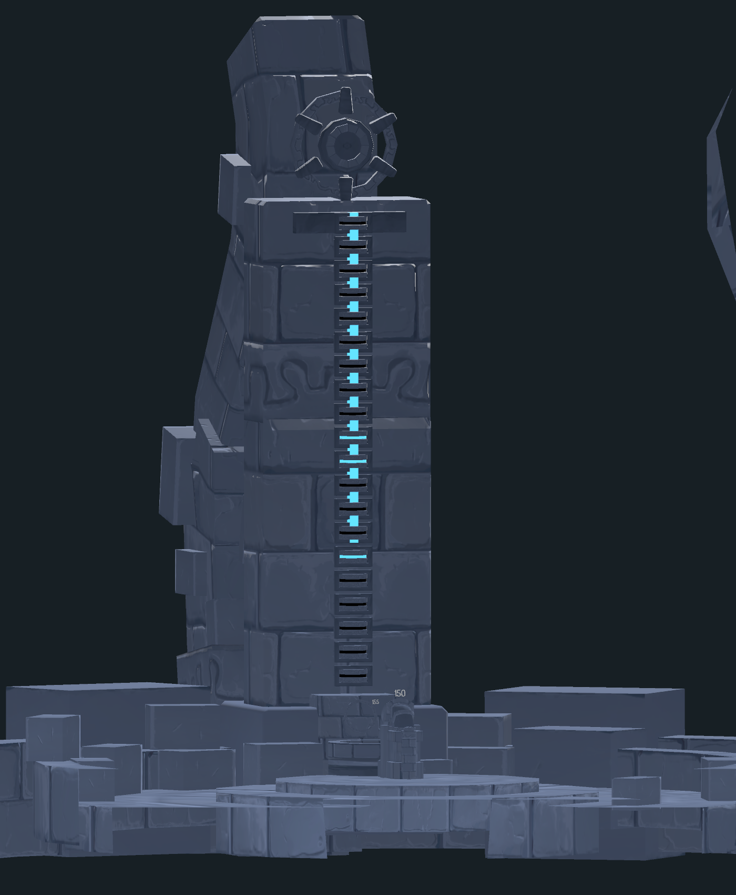

# Extended Televator

Extended Televator expands A Township Tale’s surface Televator to 20 stops, from floor 10 to floor 200 in increments of 10. It uses the existing wheel, with the original wheel travel per stop. Stone backs the column of lights, with the original rung behind the floor 10 light and the carved star standing on the cap. The floor readout sits above the wheel, and the crystal cost uses the stock display.

[Download the latest release](https://github.com/calebv2/extended-televator/releases/latest)



## Install

1. Stop the dedicated server and close the PC client.
2. Copy `Mods/Televator200.dll` from the release ZIP into the server’s `Mods` folder and each participating PC client’s `Mods` folder. Replace an existing copy of that DLL when upgrading. A setup with one shared `Mods` folder needs one copy.
3. Start the server and reconnect with the client. Look for `Extended Televator ready. Surface stops 10 through 200.` in the MelonLoader log on both sides.

This version targets the Mono PC build of A Township Tale with MelonLoader 0.7.3. It uses the game’s native networking and runs without SyncLib. Install both sides for travel past floor 100.

## In game

Turn the existing wheel to choose a floor and check the crystal cost at the controls. Use the Televator the usual way after adding enough crystals. The native repair and crystal rules still apply. For example, the stock surface prices are 115 crystals for floor 110, 155 for floor 150, and 205 for floor 200.

The wheel offers all 20 stops. Each destination must have a registered, repaired underground Televator before you can travel there. The mod uses the underground destinations already present in your world. A world with no Televator at 200 will show the stop as unavailable.

An unmodified client can still use floors 10–100. If the wheel is parked past 100, its old gauge will show the final light. The server blocks the trip for that client, so turn the wheel back to a shallower stop or install the mod on the client.

## Build from source

Run the following from the GitHub checkout or the release ZIP’s `Source` folder. The build uses the game’s managed assemblies, the local MelonLoader assemblies, and the Unity 2020.3.23f1 Roslyn compiler. Pass `-Compiler` if your compiler is installed elsewhere. The DLL goes into `bin`.

```powershell
.\Build.ps1 -GameRoot 'C:\Games\A Township Tale'
```
